# Bash Setup Guide on Windows
So you want to run and write Bash Scripts on Windows, but a Virtual Machine (VM) is too much for you? Well you know what, there's a solution for you, and it's called WSL (or Windows Subsystem for Linux)!

## Huh, what's WSL?

Happy that you're asking! WSL, also known as Windows Subsystem for Linux, is a Windows feature that lets you run a Linux environment on your Windows machine, without the need of a heavy virtual machine or dual booting. It lets you run Linux commands (including Bash scripts!), GUI apps (Windows 11 or 10 Build 19044 or newer), etc. 

WSL runs inside of a Hyper-V virtual machine. There's two version of WSL, WSL1 and WSL2. This guide will assume you are using the latest WSL2. You can read [here](https://learn.microsoft.com/en-us/windows/wsl/compare-versions) the difference between the two, and you can use:
```powershell
wsl --set-version <distro-name> 2
```
to upgrade a specific WSL distro to WSL2. 

## I'm interested, what are the prerequisites?

You need to have either Windows 11 or Windows 10 version 2004 and higher (Build 19041 and higher). You can verify that by pressing `Windows+R`, then typing `winver`, then enter. You'll see the build number in the window that opens up, like here:  

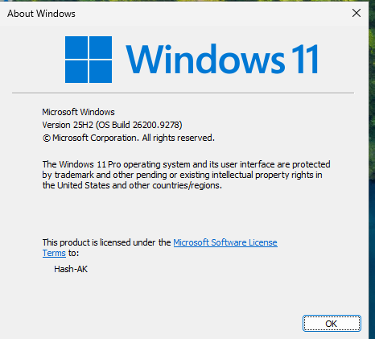  
You don't even need it to be an activated copy of Windows! 
Both ARM64 and x64 (Intel/AMD) CPUs are supported. If you're running Windows in a VM (in which case, honestly, why are you bothering to install WSL?), you must make sure that nested virtualization is enabled.

This guide will assume you are running one of the supported Windows version. If you aren't, you can still install WSL manually by following [this Microsoft guide](https://learn.microsoft.com/en-us/windows/wsl/install-manual).

## Okay, how do we install this?
I'll guide you through this!

### Step 1: Checking whether WSL is already installed
First, open a Windows CMD window as Administrator:

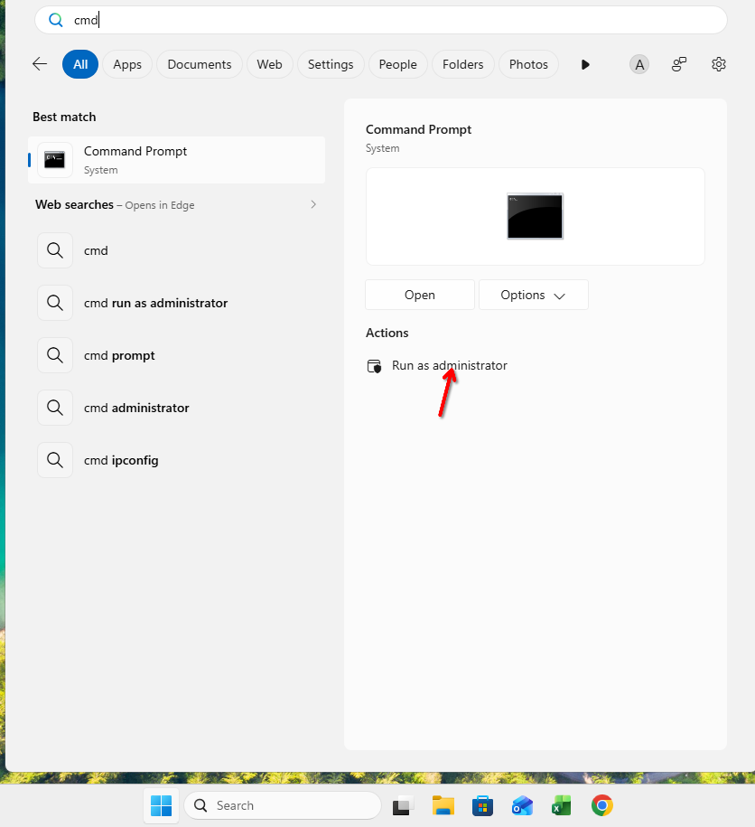

In the command prompt that opens up, type the following command to verify if WSL isn't installed already:
```powershell
wsl.exe --list --verbose
```
If you get a message like the one in the screenshot below, that means that WSL isn't yet installed on your system, so you can safely press `CTRL+C`.   

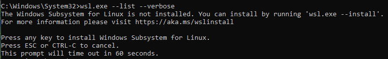

If you obtain a different message, like the one below, then that means that WSL is already installed. You can skip to step 3.  

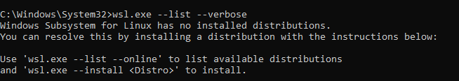  

If you see a table with a distribution you want to use, skip to the first launch section.

### Step 2: Installing WSL itself

Now we can install the WSL feature itself. Usually you install WSL with the default provided Linux distribution (usually Ubuntu), but here I'll show you how to install it with no distribution so we can choose the one we will want to work with in the next step.

Still in your Administrator command prompt, type:
```powershell
wsl --install --no-distribution
```
It will install the required components, so this may take a while. If everything goes well, the command should output:
>The requested operation is successful. Changes will not be effective until the system is rebooted.  

You can now reboot!

### Step 3: Choosing a distribution

Now that you have rebooted, check that everything works fine by opening an Administrator CMD and running again:
```powershell
wsl --list --verbose
```
You should get a message telling you that no distribution is currently installed, like shown below:


As the message suggests, we can run:
```powershell
wsl --list --online
```
to list distributions that are available for download. It gives quite a long list:

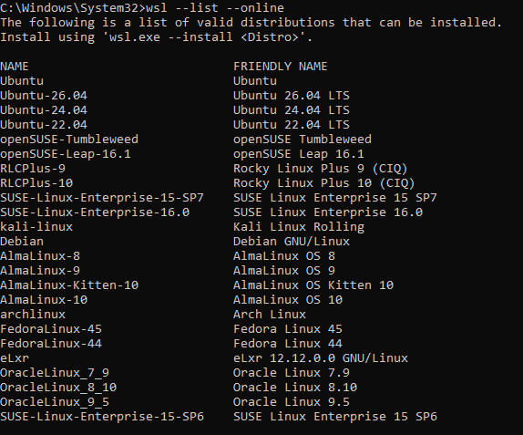

I won't cover what each distribution is, but here's a quick breakdown of the important ones (if you don't know which to pick, a safe choice would be Ubuntu):

- Debian: a pretty stable and relatively user-friendly distribution, uses the _apt_ package manager.
- Ubuntu: based on Debian, more user-friendly, also uses the _apt_ package manager.
- Kali Linux: a hacking distribution based on Debian. Not really useful if you don't need the hacking tools included in it. Also uses the _apt_ package manager.
- Arch Linux: a bleeding-edge distribution, less user-friendly than Debian-based distributions, but gets you the latest software by default. Uses the _pacman_ package manager.
- Fedora: a bleeding-edge distribution, although more stable than Arch. Uses the _DNF_ package manager.

For this guide we will stay with something simple (as we really don't need anything more than running Bash scripts) and we will take Ubuntu. If you prefer to use another distribution, that's your call, just make sure to use the correct package manager command when needed, as for the rest of this guide we will assume that you are using _apt_.

When you're ready, you can run:
```powershell
wsl --install <distribution name>
```
to install your chosen distro. Here I'm installing Ubuntu:


(You may get, like me, a message saying that nested virtualization isn't available. For some reasons it appears but if the installation continues then you're fine).  
When this is done you'll get a prompt saying `Create a default Unix user account:`. Type the username that you wish to use inside of this WSL instance, then press `Enter`, then choose a password and confirm it.

Opt out of the analytics by typing `n` then `Enter` and... we're in!  

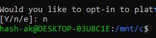

### Step 4: Updating

Now that we're inside of the system, the first thing we should do is updating. On Ubuntu (or any Debian-based systems), you can do so by running:
```bash
sudo apt update
sudo apt upgrade -y
```
This may take a while, so be patient!
When the updates are done, you'll now have a fully up-to-date Linux environment!

### Step 5: Launching it again

If you ever close the previous window, you may (potentially) want to be able to reopen WSL. You have quite a few options to do so:

#### From PowerShell or CMD
You can run:
```powershell
wsl --distribution <Distribution Name>
```
You can also alternatively add `--user <User Name>` to launch with a specific **existing** user of the WSL distro you're trying to launch.

#### From the Start Menu
You can search the name of your installed WSL distro from the Start Menu and launch it like you'd launch an app:

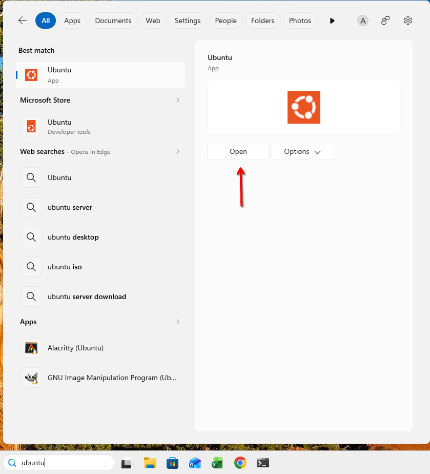

#### From Windows Terminal
If you have the [Windows Terminal](https://apps.microsoft.com/detail/9n0dx20hk701), you'll see a new option with the name of your distribution in the dropdown menu in Terminal:

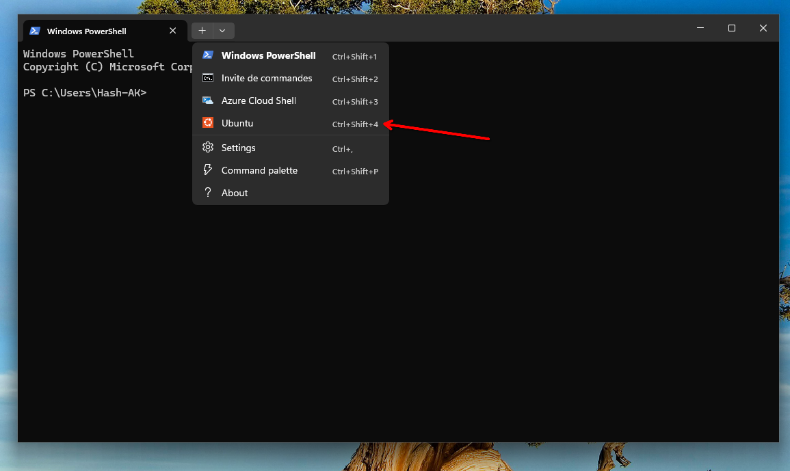

## How does it integrate with Windows?

We will see a few of the things that WSL can do in integration with Windows.

### Running GUI apps

You can install GUI apps on WSL and see them in Windows! For example, let's install the GNU Image Manipulation Program (GIMP):
```bash
sudo apt install gimp -y
```
After it's done installing, you can launch it from the WSL terminal with `gimp`:

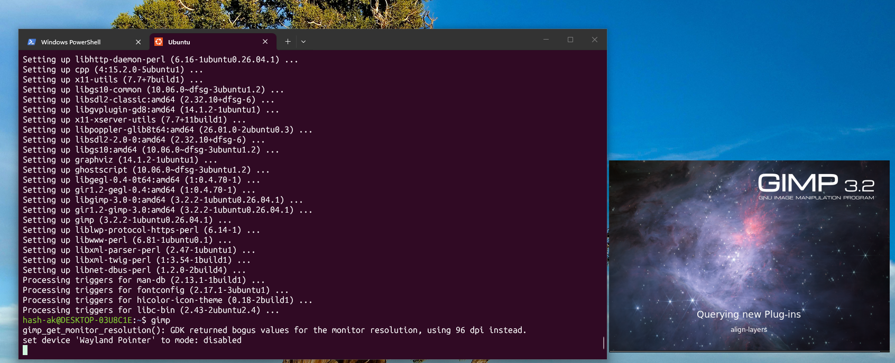

It opens! What's even cooler is that it's now also available from the Windows Start menu :

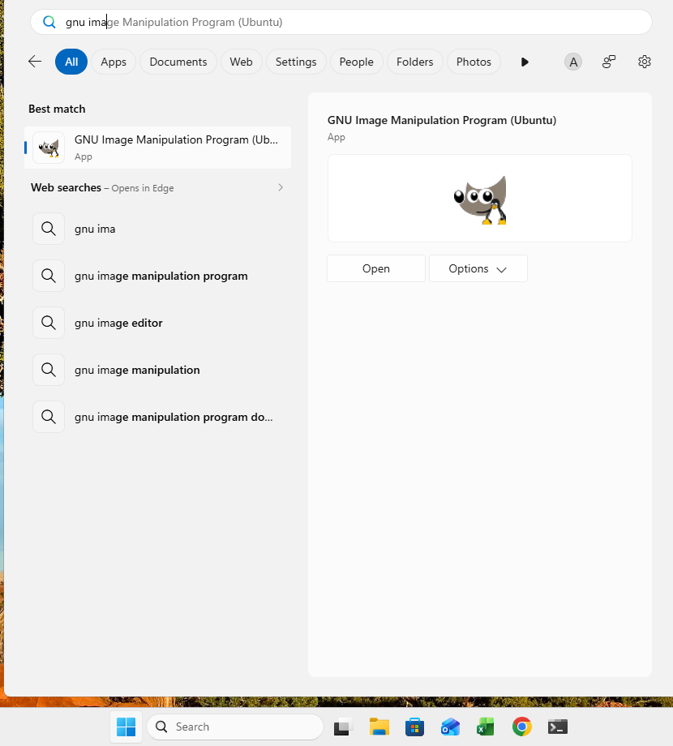

(Do note that launching a WSL app from the menu may be slightly slow if your WSL Linux isn't already running as it will have to be started before the app will launch)  

One caveat, as [Microsoft's guide says](https://learn.microsoft.com/en-us/windows/wsl/tutorials/gui-apps): 
>Support for GUI apps on WSL does not provide a full desktop experience. It relies on Windows desktop, so installing desktop-focused tools or apps may not be supported. To request additional support, you can file an issue in the WSLg repo on GitHub.

But normal apps should work fine, though.
### Accessing Windows files in WSL

You can access your `C:` drive by going in the `/mnt/c` directory:
```bash
cd /mnt/c
```
Your C drive content will appear here.
You can also mount other NTFS mounted drives inside of WSL with:
```bash
sudo mount -t drvfs <Drive Letter>: /mnt/<drive letter>
```
for example:
```bash
sudo mount -t drvfs D: /mnt/d
```

### Accessing Linux files from Windows
You may want to access your Linux files from Windows. There's multiple ways of doing so:

#### From Explorer
You can open Windows' File Explorer. You'll see a new "Linux" option on the left bar. By clicking on it, you'll see the different drives for your installed WSL distros:

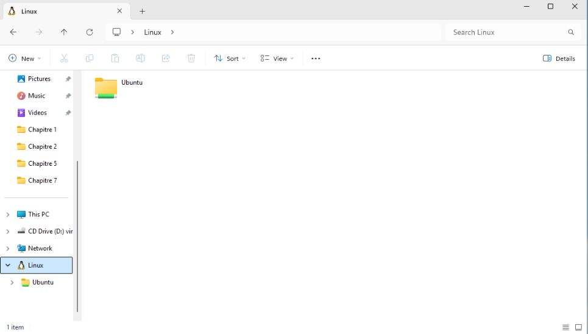  
You'll be able to access all of it's subdirectories too, by clicking inside of that folder, but in so cases you may get a "Permission Denied" prompt, like shown here:

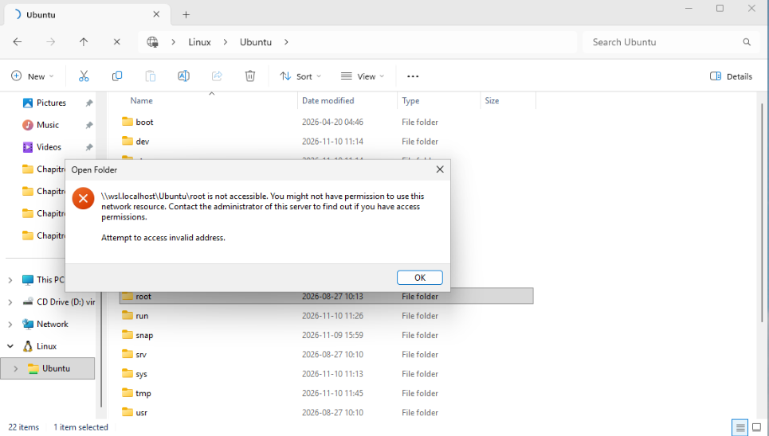

#### From PowerShell/CMD
You can also access the WSL directories from PowerShell/CMD. You can do that by opening either of the two, and typing:
```powershell
cd \\wsl.localhost\<Name of your distro>
```
For example, for me, to access my home folder in my Ubuntu WSL:
```powershell
cd \\wsl.localhost\Ubuntu\home\hash-ak
```
But again, if you're trying to access something the normal WSL user doesn't have access to (for example `/root`) you'll get an access denied.

### Running Windows commands in WSL

WSL lets you run Windows binaries inside of your WSL environment. For example, launching Windows' `Explorer.exe` inside of a directory in WSL, just run:
```bash
explorer.exe .
```

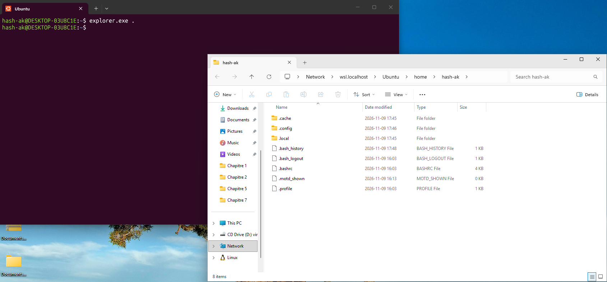

### Running Linux commands in Windows

You can do the opposite and run Linux commands on Windows! You just prefix the command you want to run with `wsl`, so for example here, running `ls` in CMD from WSL:

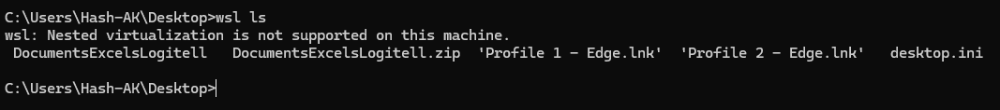  
Do note that as for launching GUI apps from the Start Menu, if your WSL system is not running yet it can take some time before the commands run, even if it's a simple one.

It can also allow you to run Bash scripts from your Windows drive with `wsl bash .\<script in the local folder>`   
If the script act weirdly or complain about `\r` characters, read the next section!


## Problems you may encounter
### `bad interpreter` or errors about `\r`
If you ever try to run a Bash script you wrote inside of Windows (say from Notepad), you may encounter an annoying error where the script fail to start and gives errors like `bad interpreter` or errors about `\r` at the end of some lines while you don't see that `\r` when in Notepad. That's normal and expected.

Linux uses **LF** lines ending, which mean that for Linux a line ends when the `\n` control character is present. Meanwhile, in Windows, **CRLF** is used, which means that a line ends when both `\r` and `\n` is present. So when you run a file edited with a Windows tool inside of Linux, it detects the `\n` file but doesn't get what `\r` is, thus failing. Fixing this is very easy, though!

First of all you can verify if a file has LF or CRLF line ending by running:
```bash
file <path to the file>
```
inside of your WSL environment (or prefix it with `wsl` if you're inside of PowerShell, as mentioned in the [above section](#running-linux-commands-in-windows)).  
If you see something like this:  

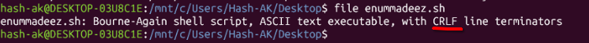  
then that means that you first need to convert it to LF. 

To do so, install `dos2unix` on your WSL system. On Ubuntu, simply run:
```bash
sudo apt install dos2unix -y
```
When it's done installing, just run:
```bash
dos2unix <path to the file to convert>
```

  
You can verify again with the `file` command afterward:

  
Do note that at least from my testing, reopening the file with Notepad keeps the correct line ending, so you do not need to reconvert it each time.

Some distros also ship `unix2dos`, which act like `dos2unix` but the other way around, if it's ever needed.

### Easily converting Windows/Linux paths to Linux/Windows paths
If you ever need to convert a path from WSL to Windows, or the opposite, WSL ships with a tool called `wslpath` which lets you easily convert one to another.

For example, I want to convert the path to the script on my Windows desktop to WSL to be able to run it. I simply run:
```powershell
wsl wslpath -ua "'C:\Users\Hash-AK\Desktop\helloworld.sh'"
```

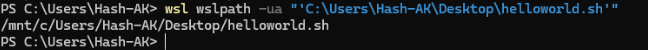  
The quotes are needed so that neither PowerShell nor WSL strips the backslashes from the Windows path.
`-ua` means "convert to Linux absolute path".  

To output Windows path from a Linux path, use `-w`:


## Your first script: path-convert

Now that you have a fully working Linux environment, let's write a little wrapper around `wslpath` to test out what we learned.

First create a new text file on your (Windows) desktop. Call it whatever you want, I'll call mine `path-convert`.

Open it with Notepad, and paste the following in it:
```bash
#!/usr/bin/env bash
if [[ -z "${1:-}" ]]; then
    echo "Usage: path-convert <path>" >&2
    exit 1
fi

if [[ $1 == *:* ]]; then
    wslpath -ua "$1"
else
    wslpath -wa "$1"
fi
```
A quick breakdown of what it does:
- The first line (the shebang) makes sure that you can execute the script without specifying what to launch it with(e.g., Bash)
- `-z "${1:-}"` verify if the passed argument (`$1` in Bash) isn't empty, if it is it will print the usage string
- `$1 == *:*` verifies if the path contains the string `:` (which is the wrapper's way of knowing if it's a Windows path, like `C:\system\`), if it does it will run the Windows to WSL conversion command
- Else, it will run the WSL to Windows command.

Save the file, but make sure to choose "Save as type: All Files" and instead of `.txt` add `.sh` at the end of the file's name.

Then, using `dos2unix`, convert it to an LF ending file.  

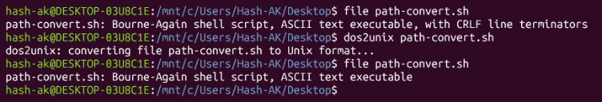  

Finally, to be able to call it from any directory in WSL, you need to add it to the `PATH` variable. You can do so by putting it in `/home/<your user>/.local/bin` (create the directory if it doesn't exist yet):
```bash
mv <path to the file on your desktop> ~/.local/bin/<name of the command without .sh at the end>
chmod +x ~/.local/bin/<name of the command>
```
Run the above commands from WSL. They move your script in `~/.local/bin`, then add the `x` permission bit, which let you execute it. Use `cp` instead of `mv` if you want to keep a copy of the script on your desktop.  

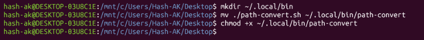  
Close your session then reopen it before trying to use your command

Now you can use your newly-created command by running:
`<name you gave your script> <a path to convert>`  

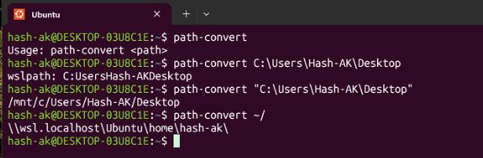

As you can see though, you need to quote Windows paths or else backslashes will get stripped.

_(Do note that this wrapper is an example only and won't cover all edge cases, like relative path. Feel free to make it better though!)_

## Conclusion

If you followed along until here, congrats! You now should have a fully working Linux environment on Windows, and a small path converter script!


